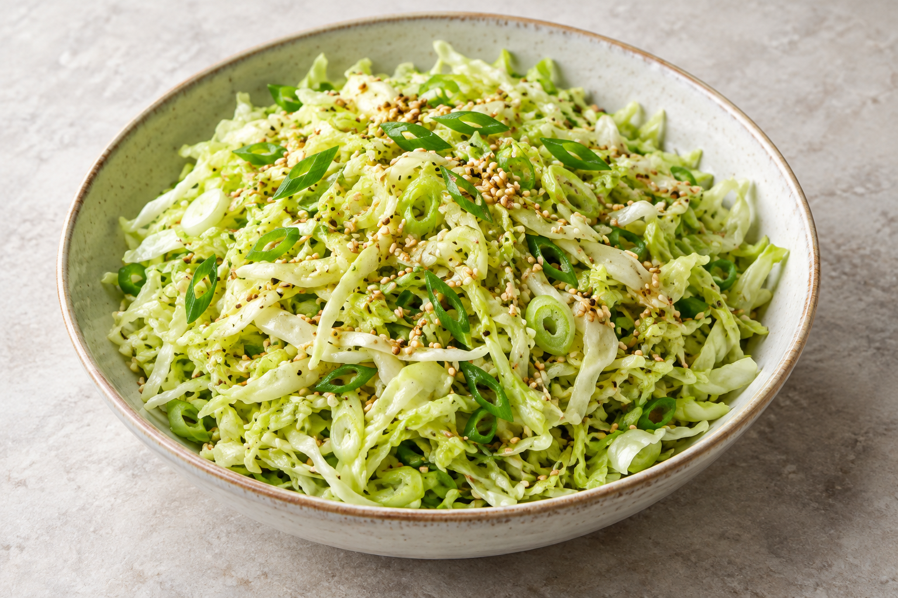

# Cabbage, lime & sesame salad

No cooked version has been reported yet. The proposed six-person recipe is recorded in [the recipe log](log.md) and the [dinner plan](../../miso-cod-dinner-for-six.html).

## Ingredients

- Pending the first cooked version; proposed quantities are in the log.

## Steps

1. Pending the first cooked version; proposed preparation is in the log.

## Notes

- No sugar or soy here: lime and crunchy cabbage give a different balance from the cucumber salad.
- Shred cabbage and mix dressing up to 24 hours ahead. Refrigerate separately. Toast sesame ahead and keep dry at room temperature.

## Last Log

- 2026-10-02: selected for dinner for six. A first-cook proposal was recorded; cooking, modifications and results are not yet reported.
