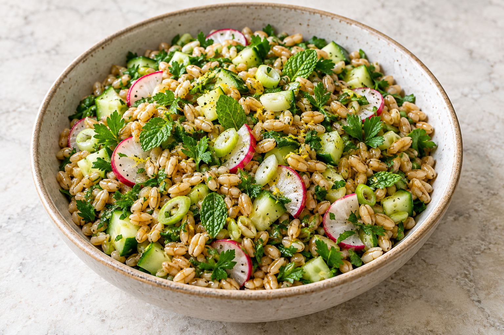

# Herby oat groat salad

No cooked version has been reported yet. The proposed six-person recipe is recorded in [the recipe log](log.md) and the [dinner plan](../../miso-cod-dinner-for-six.html).

## Ingredients

- Pending the first cooked version; proposed quantities are in the log.

## Steps

1. Pending the first cooked version; proposed preparation is in the log.

## Notes

- The total 8 g salt includes 6 g in cooking water that is mostly drained away. Cooked yield varies; use the entire batch from 240 g dry groats.
- Cook the groats and mix the dressing up to 24 hours ahead. Store separately in the refrigerator. Keep chopped vegetables separate; add herbs and sesame at service.

## Last Log

- 2026-10-02: selected for dinner for six. A first-cook proposal was recorded; cooking, modifications and results are not yet reported.
