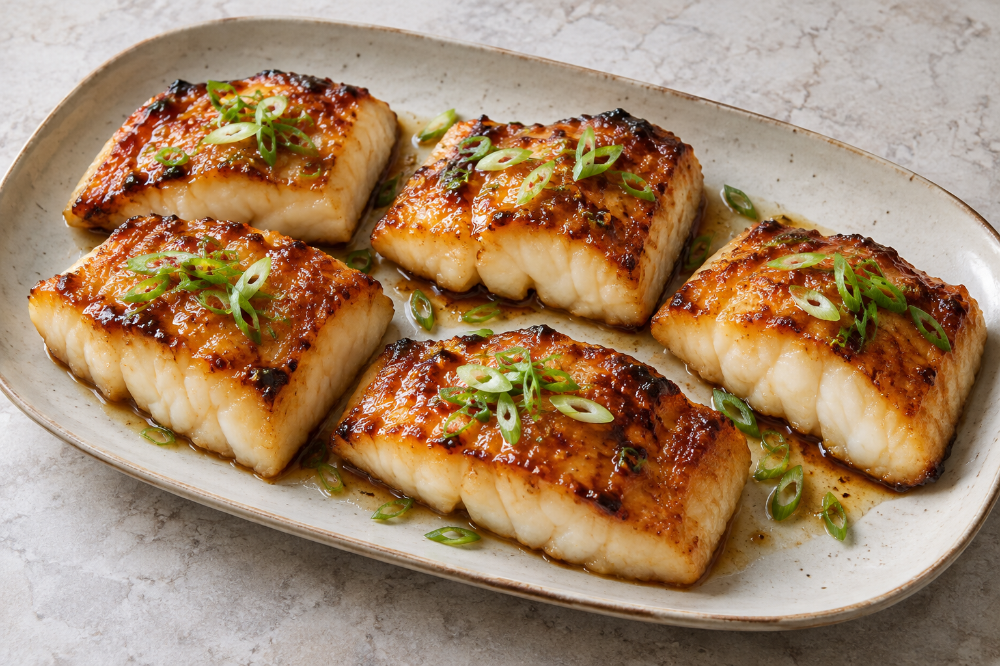

# Miso-glazed cod

No cooked version has been reported yet. The proposed six-person recipe is recorded in [the recipe log](log.md) and the [dinner plan](../../miso-cod-dinner-for-six.html).

## Ingredients

- Pending the first cooked version; proposed quantities are in the log.

## Steps

1. Pending the first cooked version; proposed preparation is in the log.

## Notes

- Use true cod for these timings. A probe thermometer is more reliable than a fixed cooking time. All six portions cook simultaneously.
- Glaze: up to 24 hours ahead, covered and refrigerated. Portion and pin-bone the cod ahead; keep it separate and cold until coating.

## Last Log

- 2026-10-02: selected for dinner for six. A first-cook proposal was recorded; cooking, modifications and results are not yet reported.
