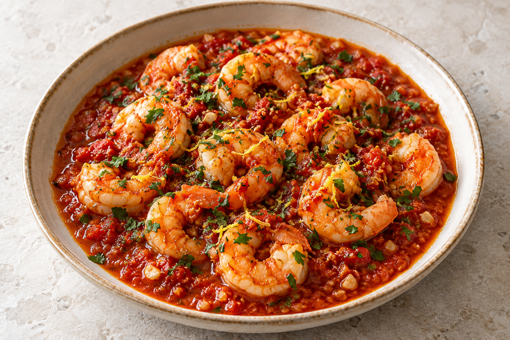

# Shrimp in tomato–garlic sauce

No cooked version has been reported yet. The proposed six-person recipe is recorded in [the recipe log](log.md) and the [dinner plan](../../miso-cod-dinner-for-six.html).

## Ingredients

- Pending the first cooked version; proposed quantities are in the log.

## Steps

1. Pending the first cooked version; proposed preparation is in the log.

## Notes

- 500 g peeled shrimp provides a small additional dish for six, alongside the cod. A wide pan prevents crowding.
- Reduce the tomato sauce up to 24 hours ahead, cool promptly in a shallow container and refrigerate. Keep raw shrimp separately refrigerated; cook at service.

## Last Log

- 2026-10-02: selected for dinner for six. A first-cook proposal was recorded; cooking, modifications and results are not yet reported.
